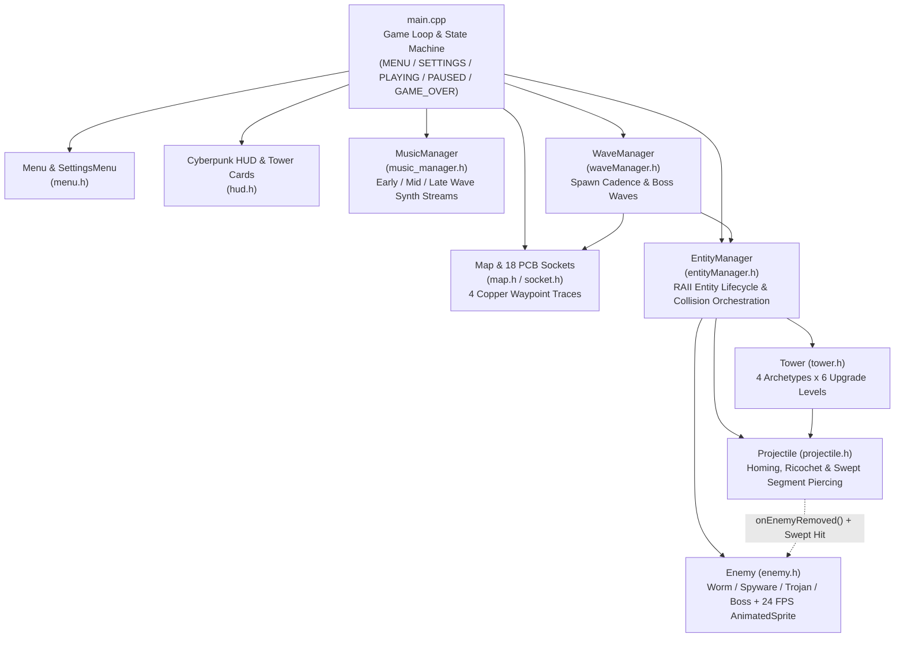

# Cyber Defense - Hardware-Themed 2D Tower Defense (C++20 / Raylib)

[](#technical-highlights)
[](#how-to-build--run)
[](#how-to-build--run)
[](LICENSE)

**Cyber Defense** is a real-time tactical tower defense game built from scratch in **C++20** and **Raylib 5.5**. Set directly on a motherboard PCB, you play as a **System Administrator** defending the **CPU** against waves of Worms, Spyware, Trojans, and Boss rootkits infiltrating across four independent copper data buses.

---

## Technical Highlights

- **Swept Segment-Circle Continuous Collision Detection (`src/projectile.h`):** High-velocity piercing railgun shots (`800 px/s`, scaling up to `3200 px/s` at `4x` game speed) project each frame's displacement vector $\overline{P_{t-1}P_t}$ onto enemy bounding circles (`SegmentIntersectsCircle`) so fast projectiles never tunnel through targets at high simulation multipliers.
- **6-Tier Modular Tower Progression (`src/tower.h`):** Four specialized security modules (**Firewall**, **Logic Bomb**, **Defragmenter**, **Data Spike**), each featuring 6 distinct sprite evolutions (`24` tower textures) and milestone mechanics including twin-shot volleys, closest/furthest dual targeting, chain ricochets, micro-stuns, armor-shredding debuffs (`+30%` damage amplification), and persistent **Data Corruption** AoE zones (`DamageZone`).
- **Deterministic Memory Safety & RAII Lifecycle (`src/entityManager.h`, `src/projectile.h`):** Non-copyable resource owners (`EntityManager`, `AnimatedSprite`, `MusicManager`, `Map`, `HUDAssets`), observer-style target invalidation (`Projectile::onEnemyRemoved`) prior to enemy deallocation, safe UI selection clearing on tower sales, and unified texture/audio teardown across all exit paths.
- **Multi-Lane PCB Navigation & Tiered Wave Scaling (`src/map.h`, `src/waveManager.h`, `src/enemy.h`):** Four hand-mapped motherboard copper traces and `18` interactive component sockets operating in a canonical `1600x900` virtual coordinate space with dynamic scaling across `1280x720`, `1600x900`, `1920x1080`, and fullscreen modes, plus speed-adaptive waypoint arrival thresholds that prevent overshooting at `4x` speed.
- **Adaptive Wave-Phase Synth Soundtrack (`src/music_manager.h`, `assets/songs/`):** Includes 4 custom procedurally synthesized, 100% royalty-free retro-synth `.wav` loops (`menu_theme.wav`, `early_wave.wav`, `mid_wave.wav`, `late_wave.wav`) that transition seamlessly across **Early** (`Waves 1–5`), **Mid** (`Waves 6–10`), and **Late** (`Wave 11+`) combat phases, guarded with `IsAudioDeviceReady()` and `IsMusicValid()` checks.

---

## System Architecture



---

## Security Modules & Malware Overview

### Defensive Towers (Levels 1–6)
| Tower | Cost | Role | Signature Upgrades |
| :--- | :---: | :--- | :--- |
| **Firewall** | `100 BC` | Rapid Point Defense | Twin shots (Lv2), range/damage boost (Lv3), chain ricochet (Lv4), rapid burst (Lv6) |
| **Logic Bomb** | `250 BC` | Heavy Artillery & DoT | Dual closest/furthest targeting (Lv2), persistent `3.5s` Data Corruption AoE field (Lv4) |
| **Defragmenter** | `150 BC` | Cryo Crowd Control | `50%` slow, chain bounce (Lv3), `0.2s` stun (Lv4), `3.5s` slow (Lv5), triple spread (Lv6) |
| **Data Spike** | `300 BC` | Piercing Railgun | Multi-target swept beam, wider rail (Lv2), `+30%` Armor Pierce debuff (Lv4), twin beams (Lv6) |

### Hostile Malware
| Malware | Base HP | Speed | Reward | Notes |
| :--- | :---: | :---: | :---: | :--- |
| **Worm** | `20` | `150 px/s` | `10 BC` | Fast swarm packets (Waves 1+) |
| **Spyware** | `60` | `100 px/s` | `25 BC` | Balanced mid-tier infiltrator (Waves 3+) |
| **Trojan** | `250` | `50 px/s` | `100 BC` | Heavy armored payload (Waves 5+) |
| **Boss Rootkit** | `1500+` | `40 px/s` | `500 BC` | Siege boss spawned every 10th wave |

See [GDD.md](GDD.md) for full mathematical formulas and level-by-level balance tables.

---

## Controls

| Key / Mouse | Action |
| :--- | :--- |
| **Left Click** | Select tower card, build on a highlighted PCB socket, or upgrade a selected tower |
| **Right Click** | Sell tower on the hovered socket (`+75 BC`) |
| **`1` – `4`** | Select **Firewall** (`1`), **Logic Bomb** (`2`), **Defragmenter** (`3`), or **Data Spike** (`4`) |
| **`SPACE`** | Start the next wave immediately |
| **`T`** | Cycle game simulation speed (`1x` / `2x` / `3x` / `4x`) |
| **`F`** | Toggle fullscreen |
| **`ESC`** | Pause game / return to Main Menu |

---

## How to Build & Run

### Prerequisites
- **Windows 10/11 (x64)**
- **Visual Studio 2022 or 2026** with the **Desktop development with C++** workload
- **NuGet Package Manager** (built into Visual Studio; restores `raylib 5.5.0` via `CyberDefense/packages.config`)

### Option 1: Visual Studio (`CyberDefense.slnx`)
1. Clone the repository:
   ```powershell
   git clone https://github.com/<your-username>/cyber-defense-raylib.git
   cd cyber-defense-raylib
   ```
2. Open `CyberDefense.slnx` in **Visual Studio**.
   *(Note: `CyberDefense.vcxproj` targets Platform Toolset `v145` (Visual Studio 2026). If building with Visual Studio 2022, right-click the `CyberDefense` project -> **Properties** -> **General** -> **Platform Toolset** and select **Visual Studio 2022 (v143)**.)*
3. Restore the `raylib 5.5.0` NuGet package:
   - Right-click the solution in **Solution Explorer** -> **Restore NuGet Packages** (or run `nuget restore CyberDefense\packages.config -PackagesDirectory packages`).
4. Set the active configuration to **`Release | x64`** (or **`Debug | x64`**) and press **`F5`** to build and launch.
   *(Asset discovery in `GetAssetPath()` automatically resolves `assets/` from the repository root or parent directories.)*

### Option 2: Command-Line MSVC (`cl.exe`)
From a **Visual Studio x64 Native Tools Command Prompt** (after restoring `packages/raylib.5.5.0`):
```bat
cl /std:c++20 /EHsc /O2 /MD /DPLATFORM_DESKTOP /DGRAPHICS_API_OPENGL_33 ^
   /I src /I packages\raylib.5.5.0\build\native\include src\main.cpp ^
   /Fe:CyberDefense.exe ^
   /link packages\raylib.5.5.0\build\native\lib\x64\raylib.lib ^
   winmm.lib gdi32.lib user32.lib shell32.lib opengl32.lib
```

---

## Project Structure

```text
cyber-defense-raylib/
├── assets/
│   ├── enemies/            # 24 FPS PNG sprite frame sequences (Worm, Spyware, Trojan)
│   ├── menu/               # Main menu background artwork
│   ├── songs/              # Royalty-free synthesized retro-synth WAV soundtrack
│   ├── towers/             # 4 tower classes x 6 upgrade tier sprites (24 PNGs)
│   ├── ui/                 # HUD & module icon assets
│   └── map.jpg             # Motherboard PCB battlefield texture
├── CyberDefense/
│   ├── CyberDefense.vcxproj
│   ├── CyberDefense.vcxproj.filters
│   └── packages.config     # NuGet dependency (raylib 5.5.0)
├── src/
│   ├── animated_sprite.h   # Frame-rate independent PNG sequence animator
│   ├── constants.h         # Virtual 1600x900 scaling & recursive asset path resolver
│   ├── enemy.h             # Malware stats, status effects & tiered wave scaling
│   ├── entity.h            # Abstract base Entity interface
│   ├── entityManager.h     # RAII entity lifecycle, AoE zones & safe pointer cleanup
│   ├── hud.h               # Cyberpunk HUD panels, health bar & tower selection cards
│   ├── main.cpp            # Entry point, state machine, input & resource teardown
│   ├── map.h               # 4 PCB copper waypoint traces & 18 buildable sockets
│   ├── menu.h              # Main menu & live resolution/fullscreen settings
│   ├── music_manager.h     # Guarded wave-phase audio streaming (Early/Mid/Late)
│   ├── projectile.h        # Homing, ricochet & swept segment-circle collision
│   ├── socket.h            # Interactive PCB tower socket hitboxes
│   ├── tower.h             # 4 tower archetypes & 6-level upgrade logic
│   └── waveManager.h       # Wave progression & Boss wave scheduling
├── CyberDefense.slnx       # Visual Studio solution
├── GDD.md                  # Game Design Document
└── LICENSE                 # MIT License
```

---

## Team & Attribution

Developed originally as the **SENG 479 — Game Programming** final project (instructed by Lect. Batuhan Hangün) by a 7-person engineering team:
- **Berke Cinkol** — Visual Studio solution/project build configuration (`.slnx`/`.vcxproj`), NuGet `raylib 5.5.0` integration, technical documentation, and post-course portfolio engineering (eliminated same-frame projectile/enemy & tower-sell use-after-free bugs, enforced RAII/non-copyable resource ownership across `EntityManager`/`Map`/`AnimatedSprite`/`MusicManager`, unified GPU/audio cleanup on exit, and built the procedural royalty-free retro-synth soundtrack)
- **Davut Özcan** — Core gameplay systems & combat mechanics
- **Mustafa Özkürkçü** — Tower progression, projectile collision & asset pipeline
- **Muhammed Fatih Erayman** — Menu systems, HUD & dynamic music architecture
- **Rüveyda Ersan** — Map trace layout, enemy behaviors & visual assets
- **Mehmet Akif Kurt** — Wave balancing, gameplay mechanics & testing
- **Eda Orhan** — Game design, UI visual polish & documentation

---

## License

Released under the [MIT License](LICENSE). Built with [Raylib](https://www.raylib.com/). All included audio tracks in `assets/songs/` are original procedurally synthesized waveforms free of third-party copyright claims.
